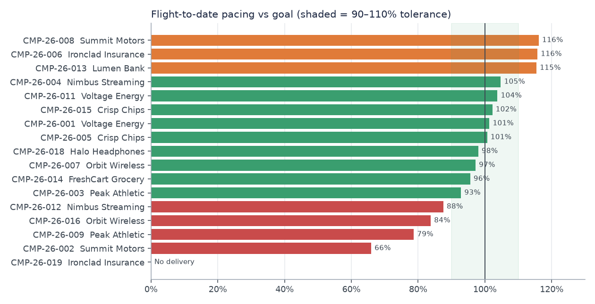

# In-Game Ad Inventory Reporting System

**[View the project page →](https://qalveen.github.io/ingame-ads-reporting/portfolio/)**

Automated monthly reporting for custom in-game advertising and sponsorship inventory across four game titles. One command takes raw client telemetry, the AdOps campaign book, and ad-server logs, then runs 14 data checks and publishes a stakeholder-ready Excel report.

> All titles, advertisers, and numbers are **synthetic** (generated by `src/generate_data.py`). The data includes realistic seasonality, pacing variance, and known data-quality defects.



## The business problem
An Ads & Sponsorships team sells branded inventory inside games: stadium LED boards, end-zone branding, lobby billboards, loading-screen video, and mobile rewarded video. Every month the team has to answer:

- **Sales:** How much inventory did we have, and how much did we sell?
- **AdOps:** Which campaigns are under- or over-delivering against what was booked?
- **Product:** Is the new placement we launched performing (fill, viewability)?
- **Revenue Strategy:** What did we earn, and at what yield (eCPM)?

The manual version of this report means per-studio exports, copy-pasted campaign lists, and hand-built pivot tables. Totals don't reconcile, and nobody can reproduce last month's numbers. This repo replaces that with a documented, tested, reproducible pipeline.

## What it does
```
AdOps scope CSV ─┐
Campaign book ───┤      staging       intermediate          marts              tests          publish
Telemetry ───────┼──>  (dedup, MRC  ──> (classify every ──> (campaign,   ──> 9 blocking  ──> Excel report
Ad server log ───┤      viewability)     impression,         placement,       5 warnings      + charts
Placement catalog┘                       cap billable)       title, freq)                     + run log
```

| Capability | How |
|---|---|
| AdOps scope alignment | Monthly `config/adops_scope_YYYY-MM.csv`. The pipeline refuses to run without it, and tests prove every approved campaign is reported and every excluded line is not. |
| Nothing silently dropped | Every impression is classified as `paid_in_flight`, `out_of_flight`, `house`, `test`, or `orphan`, so every row lands in a known bucket. |
| MRC viewability | Display ≥50% in view for ≥1s, video ≥50% for ≥2s, defined once in `stg_impressions`. |
| Billing logic | Running-total window function caps billable impressions at the booked goal. |
| Pacing | Flight-to-date delivery vs. a straight-line goal, with a 90–110% tolerance. |
| New inventory | Placements launched in the month are flagged automatically from the Product catalog. |
| Mobile gap | Ad-server fills are compared with client telemetry per placement, and gaps above 2% are flagged. |
| Auditability | KPI definitions live in one YAML file. Every run writes `run_log.json` with row counts, test results, and timings. |
| Publication gate | Any error-severity test failure blocks the report. |

## September 2026 results (synthetic)
- 609K raw telemetry rows → 2,419 retry duplicates removed → **331K paid impressions**, $5.1K billable revenue, $15.26 eCPM
- **4 placements below 70% viewability.** Kit sponsor overlay is lowest at 29%.
- **4 campaigns under-pacing.** Summit Motors is lowest at 66% of goal, 8,000 impressions behind. **1 booked campaign has no delivery.**
- **3 campaigns over-pacing (115–116%).** The billable cap stops the over-delivery from being invoiced.
- **New GRD skills-challenge placement:** 98% viewability but only 30% sell-through, which is a Sales opportunity.
- **Mobile title (HTL):** telemetry is about 3% below ad-server fills, pointing to beacon loss. This is flagged for AdTech.

## Quick start
```bash
git clone https://github.com/qalveen/ingame-ads-reporting.git && cd ingame-ads-reporting
python3 -m venv .venv && source .venv/bin/activate
pip install -r requirements.txt
make all                    # generate data, render docs, build Aug + Sep reports
open output/2026-09/AS_Inventory_Report_2026-09.xlsx
```
To run a single month: `python src/run_pipeline.py --month 2026-09`.

## Report tabs
Summary (KPI tiles, auto-written callouts, title table, trend) · Title KPIs (with MoM) · Campaign Detail (pacing, billing, totals) · Placement Detail (avails, fill, sell-through, discrepancy) · Frequency · Daily Trend · Data Quality (DQ counts + every test result) · AdOps Scope · Definitions

## Repo layout
```
config/      titles.yml (placement catalog) · campaign_manifest.csv · adops_scope_YYYY-MM.csv · kpi_definitions.yml
src/         generate_data.py · run_pipeline.py · build_report.py · render_docs.py
sql/         staging/ · intermediate/ · marts/ · tests/   (run in filename order; table = filename)
docs/        kpi_definitions.md · data_dictionary.md · monthly_runbook.md · automation_log.md
bigquery/    ddl.sql (partitioned + clustered) · README.md (DuckDB → BigQuery translation)
.github/     monthly_report.yml (scheduled CI run, report uploaded as artifact)
output/      YYYY-MM/ report, charts, run_log.json
```

## Design decisions
- **DuckDB locally, BigQuery-ready.** Anyone can run it with zero cloud setup. `bigquery/` holds the production DDL and the SQL translation table.
- **dbt-style layering without dbt.** Each `.sql` file is one model, which keeps the project easy to read. Moving it to dbt is a mechanical change.
- **Tests are SQL that returns failing rows.** The severity header (`error` / `warn`) decides whether a failure blocks publication.
- **Straight-line goal proration.** It is simple and auditable. Traffic-weighted proration is listed as a next step in `docs/automation_log.md`.

## Limitations / next steps
- The CI workflow uses the synthetic generator. A real deployment would swap that step for a warehouse extract and pull the AdOps scope from a shared sheet.
- Unique reach is an exact distinct count per month. It is not additive across titles; cross-title deduplicated reach is a separate project.
- Mobile reconciliation is at the placement-day level. Impression-level matching needs a mediation feed.
